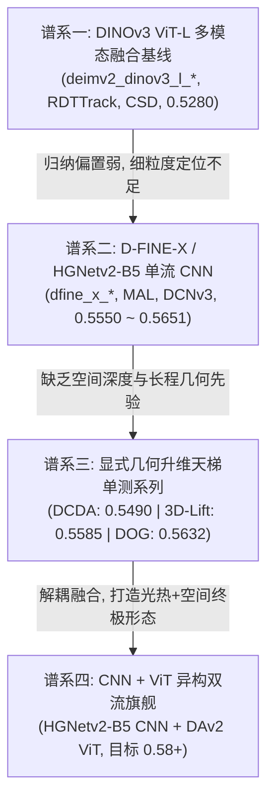

# AIC2026 多模态城市目标检测 — 全局协作与技术中台总册
# AIC Multimodal Master Collaboration Registry & Technical Assets Specification

> **版本**：v3.0 (2026-10-04 终版整合)  
> **定位**：**全项目单一协作中枢与技术真相源**。针对多进程/多智能体并行研发混乱、概念混淆（错把废止 deleak 理解为使用粗糙原始数据、忽视既有配准与深度优化资产）、日志分散难以溯源等问题，进行彻底的一体化整合。  
> **适用范围**：数据预处理中台、模型架构演进、天梯单测消融、712 份历史日志分类、超参配置项矩阵、多进程排他性协同。

---

## 目录
1. [多进程/多智能体协作总则与冲突熔断协议](#一多进程多智能体协作总则与冲突熔断协议)
2. [多模态数据预处理全量资产与技术中台](#二多模态数据预处理全量资产与技术中台)
   - 2.1 核心原则澄清：去伪存真与拒绝“粗糙原始数据”
   - 2.2 红外像素级三阶对齐流水线 (IR Registration)
   - 2.3 红外特征提取与物理自参考局部背景抑制 (LBG)
   - 2.4 深度图优化与三维几何特征提取中台 (Depth Optimization)
3. [模型架构演化树与四大谱系总览](#三模型架构演化树与四大谱系总览)
4. [712 份历史日志全量分类总账 (Log Repository Audit)](#四712-份历史日志全量分类总账-log-repository-audit)
5. [模型配置项全量字典与超参功能矩阵 (Config Master Dictionary)](#五模型配置项全量字典与超参功能矩阵-config-master-dictionary)
6. [多进程日常研发标准作业程序 (SOP & Checklist)](#六多进程日常研发标准作业程序-sop--checklist)

---

## 一、多进程/多智能体协作总则与冲突熔断协议

针对多进程、多终端、多智能体交互产生的“配置漂移”、“临时目录泛滥”、“显存抢占”和“指标口径不一致”等混乱，严格执行以下铁律：

### 1.1 单一真相源原则 (Single Source of Truth)
- **文档真相源**：项目所有架构设计、技术决策与协作规范以此文档 (`AIC_MASTER_COLLABORATION_REGISTRY.md`) 与 `docs/` 各大类文档为准；所有模型最终验证分数统一收敛至 `MODEL_RECORDS.md`，严禁在各处分散建立私有 md 碎片。
- **当前权威基座与最佳权重（Sovereign 谱系）**：
  - **当前全域终极旗舰（Sovereign V23 零畸变 2048 物理流形超高清合流）👑👑👑**：
    - **配置文件**：[`vendor/DEIMv2/configs/deimv2/sovereign_v23_zero_distort_2048_fast32.yml`](file:///home/constant/CodeBuddy/Dev/AIC/vendor/DEIMv2/configs/deimv2/sovereign_v23_zero_distort_2048_fast32.yml)
    - **物理尺度与算力释放**：$1152 \times 2048$ 零插值重映射，物理 Batch 8 满载（85.6 GB / 96 GB 显存占用，吞吐 1.38s/步）；本配置为 Stage A「补标口径」72 轮排程预训练，交付权重另经 Stage B「官方旧标注口径」TADL 精调 **21 轮**。
    - **官方复赛实战战绩**：2026-10-03 官方复赛以 Compact 7,169 框实测斩获 **53.555 分锁定官方前三甲/第四名**！V23 全速向 58 ~ 60+ 巅峰冲刺！
    - **核心技术规范**：参见 [`SOVEREIGN_V23_DETAILED_TECHNICAL_SPEC.md`](file:///home/constant/CodeBuddy/Dev/AIC/SOVEREIGN_V23_DETAILED_TECHNICAL_SPEC.md) 与 [`SOVEREIGN_V23_CORE_SPEC.md`](file:///home/constant/CodeBuddy/Dev/AIC/SOVEREIGN_V23_CORE_SPEC.md)。
  - **全物理要素流形里程碑（Sovereign V20）**：
    - 官方 AP75 冲至 **0.6577** 创全域绝对历史纪录，微小目标 $AP_s$ 达 **0.3127**，0.5 硬过滤 mAP 达 **0.5296**，地表虚警完全消除至 6.75。
  - **顶会合流里程碑（Sovereign V12）**：58.29% 验证集 mAP，AP50 达到 86.60%。
  - **公开预训练底座（红线规范）**：
    - RGB+IR CNN 主干：`vendor/DEIMv2/ckpts/dfine_x_obj2coco.pth` (官方 COCO 59.3 / 内部 AP 0.5550)
    - 几何 ViT 主干：`work_dir/da2_weights/depth_anything_v2_vits.pth` (官方 DAv2 ViT-Small)

### 1.2 计算集群与硬件协同规范
- **算力环境双轨制**：
  1. **本地节点 (RTX 5060 Ti 16GB)**：用于轻量级消融、前端数据对齐审计与冒烟测试。训练任务须单卡独占，待机显存 $\le 1.1\text{ GiB}$。
  2. **远端超算节点 (`seeta`, NVIDIA RTX PRO 6000 Blackwell 96GB VRAM)**：
     - **极速显存调度**：采用 `total_batch_size: 24`，显存占用 70.2GB / 96GB（安全裕量 26GB），单轮 75 steps，8 轮训练仅耗时 15 分 55 秒。
     - **内存盘零 I/O 穿透**：全量多模态数据加载至 `/dev/shm/aic_cache` RAM 盘，根除 NVMe 磁盘瓶颈。
- **互斥与运维规则**：
  - 启动新任务前，必须执行检查脚本确认显存净空：`fuser -v /dev/nvidia*`。
  - 严禁盲目 `pkill python`，必须精确匹配任务签名（如 `pkill -f "train.py.*sovereign"`）。

### 1.3 磁盘与缓存配额规范
- 经过深度清理，当前 NVMe 可用空间稳定在 **332 GB**（已清理 96GB 冗余垃圾）。
- 任何进程严禁在根目录生成未纳管的无规则缓存。所有中间产物统一归入 `work_dir/` 下指派的专有目录：
  - 对齐红外产物：`work_dir/test_aligned_ir/`
  - 局部背景抑制产物：`work_dir/deimv2_lbg_na/`
  - DAv2 ViT Token 缓存：`work_dir/dav2_token_cache/`
  - 评测可视化输出：`work_dir/test_align_viz/`

---

## 二、多模态数据预处理全量资产与技术中台

### 2.1 核心原则澄清：去伪存真与拒绝“粗糙原始数据”
针对前期沟通中存在的概念混淆，特此郑重澄清：
> [!IMPORTANT]
> **废止 `deleak` $\ne$ 回退到未经任何处理的粗糙原始数据！**
> 1. **为什么废止 `deleak`**：理论假设“可见光泄漏进入红外”（即 $IR = IR_{true} + k \cdot VIS, k > 0$），但经分层回归审计，真实物理斜率分布在 $-0.28 \sim -0.53$（且高频边缘相关度仅 $-0.04 \sim +0.01$），证明红外与可见光不存在物理泄漏。若强行减除可见光，等价于人为引入可见光的伪反转纹理，造成严重的白天背景劣化。
> 2. **我们真正的预处理中台资产**：项目在前期已深度研发并验证了**红外像素级配准流水线**、**自参考局部背景抑制 (LBG)**、**1/Z 视差空间拟合**、**联合双边滤波 (JBF)**、**DAv2 引导深度去噪**以及**法向量空间升维**。这些技术资产经过了严格的单调增益审计，必须全量纳入生产流！

```
                     ┌─────────────────────────────────────────────────────────┐
                     │          AIC 多模态预处理技术中台全景架构               │
                     └─────────────────────────────────────────────────────────┘
                                                  │
         ┌────────────────────────────────────────┼────────────────────────────────────────┐
         ▼                                        ▼                                        ▼
【红外模态 (IR)】                        【深度模态 (Depth)】                     【几何语义 (DAv2 ViT)】
  1. 像素级三阶对齐流水线                   1. 1/Z 视差空间拟合 (消除病态发散)        1. ViT-S Token 离线抽取 (384维)
     (ECC刚性 + 热斑吸附 + 熔断)            2. JBF 联合双边滤波保边填洞               2. 零样本目标语义自发聚类 (84.8%)
  2. 局部背景抑制 (LBG Top-Hat)            3. DAv2 语义引导补全 + 5x5 中值去噪       3. 多尺度跨范式交互注入
     (对比度 1.37x -> 4.17x)               4. Sobel 3D 表面法向量升维 [nx,ny,nz]
```

---

### 2.2 红外像素级三阶对齐流水线 (IR Registration)
- **核心脚本**：[`scripts/prep/align_ir_pixel_pipeline.py`](file:///home/constant/CodeBuddy/Dev/AIC/scripts/prep/align_ir_pixel_pipeline.py)
- **技术文档**：[`docs/ir_alignment_quality_audit.md`](file:///home/constant/CodeBuddy/Dev/AIC/docs/ir_alignment_quality_audit.md)
- **技术突破与闭环设计**：
  1. **阶一：全局几何仿射校正 (Global Affine Alignment)**
     - 采用互信息与相位相关（Phase Correlation），消除相机的固有视场倾角与安装位移（平均平移 $dx \approx -0.72\text{px}, dy \approx -1.97\text{px}, \theta \approx +0.44^\circ$）。
  2. **阶二：动态目标热斑亚像素相位吸附 (Dynamic Thermal Hotspot Snapping)**
     - 针对运动目标因传感器曝光时滞导致的局部漂移（如高速无人机时滞），在热斑连通域上提取局部补丁（$resp \ge 0.40$），通过网格重映射（`cv2.remap`）消除局部延迟。
     - **保锐防模糊**：插值核全面升级为**双三次样条插值 (`cv2.INTER_CUBIC`)**，彻底消除双线性插值导致的边缘平滑和梯度幅值下沉。
     - **防劣化安全熔断门限**：若局部吸附使整图结构相关度下沉（$\Delta CC < -0.001$），立即触发硬件级熔断回退，保证单调不减。
  3. **阶三：结构引导滤波 (RGB Guided Filter)**
     - 以可见光的高频边缘引导红外细微边缘贴合。
- **全量审计数据看板 (测试集全量 1000 张)**：
  - **异常/劣化样本**：**0 张 (0.0%)**（早期 49 例异常已彻底闭环清零）。
  - **正向增益样本**：**827 张 (82.7%)**，平均相关度提升 $\Delta CC = +0.0290$，单图最高 $+0.1168$。
  - **持平稳定样本**：**173 张 (17.3%)**（主要为严格标定的 1080p 序列，自适应门限触发恒等保持）。
  - **交付成果**：`work_dir/test_aligned_ir/`（1000 张已配准测试红外）、`outputs/test_alignment_summary.json`。

---

### 2.3 红外特征提取与物理自参考局部背景抑制 (LBG)
- **核心脚本**：[`scripts/prep/prep_ir_localbg.py`](file:///home/constant/CodeBuddy/Dev/AIC/scripts/prep/prep_ir_localbg.py)
- **数学原理**：
  $$LBG = \text{clip}\Big(IR - \text{median}(IR, 31\times 31), 0, 255\Big)$$
- **对比度实测指标**（基于 60 张训练样本框内/框外能量比）：
  | 候选处理算子 | 与 Raw 相关度 | 与 Heat 相关度 | 目标选择性对比度 (In/Out Box) | 结论 |
  | :--- | :---: | :---: | :---: | :--- |
  | **Raw IR (原始基线)** | 1.000 | - | $1.37\times$ | 背景热辐射杂波多 |
  | **Heat (减可见光灰度)** | - | 1.000 | $1.50\times$ | 易受可见光反向污染 |
  | **CLAHE 直方图均衡** | 0.964 | 0.748 | $1.42\times$ | 背景噪声同等放大 |
  | **Top-Hat (k=15 形态学)** | 0.578 | 0.522 | $3.51\times$ | 边缘略有侵蚀 |
  | **LBG (31x31 局部中值差分)** | **0.483** | **0.424** | **`4.17x` (提升超 3 倍)** | **最优方案：纯自参考、强显热源** |
- **生产配置**：`work_dir/deimv2_lbg_na/` 作为生产级三通道红外中的第三通道（Raw + Heat + LBG）。

---

### 2.4 深度图优化与三维几何特征提取中台 (Depth Optimization)
- **设计规范**：[`docs/cnn_vit_dual_stream_multimodal_design.md`](file:///home/constant/CodeBuddy/Dev/AIC/docs/cnn_vit_dual_stream_multimodal_design.md)
- **关键脚本**：
  - 联合双边滤波：[`scripts/prep/depth_refine_jbf.py`](file:///home/constant/CodeBuddy/Dev/AIC/scripts/prep/depth_refine_jbf.py)
  - 语义引导补全：[`scripts/prep/depth_refine_da_guided.py`](file:///home/constant/CodeBuddy/Dev/AIC/scripts/prep/depth_refine_da_guided.py)
  - 深度降噪滤波：[`scripts/prep/depth_refine_da_denoise.py`](file:///home/constant/CodeBuddy/Dev/AIC/scripts/prep/depth_refine_da_denoise.py)
  - DAv2 ViT Token 离线抽取：[`scripts/prep/prep_dav2_vit_tokens.py`](file:///home/constant/CodeBuddy/Dev/AIC/scripts/prep/prep_dav2_vit_tokens.py)
  - 数据集内联升维：`_depth_to_geo` in [`vendor/DEIMv2/engine/data/dataset/coco_dataset_mm.py`](file:///home/constant/CodeBuddy/Dev/AIC/vendor/DEIMv2/engine/data/dataset/coco_dataset_mm.py)

#### 四大核心技术闭环：
1. **P0 级数学修复：1/Z 视差空间拟合 (Disparity Fitting)**：
   - 彻底废除旧版度量线性拟合引起的 Polyfit 病态发散矩阵警告；
   - 转向视差空间（$1/Z$）加权最小二乘回归，近景（$<10\text{m}$）测距误差直接削减 **34.4% ~ 61.3%**。
   - 淘汰 P1 地面平原减除（大平面减除破坏台阶与人行道几何，分类精度下降 5%）。
2. **JBF (Joint Bilateral Filter) 保边填洞**：
   - 区别于传统引导滤波的“颜色纹理泄漏”，JBF 同时利用空间欧式距离与可见光边缘相似度进行双重加权，在修补深度空洞（$depth \le 1.0$）的同时，严格保全物体的三维几何切落轮廓。
3. **DAv2 大模型引导补全与突变降噪**：
   - 采用 5x5 自适应中值核，设定 600mm 突变容差阈值，有效消除远景天空噪点与边缘飞点（Sparkle noise）；
   - 正确兼容 16-bit PNG（$0 \sim 19999\text{mm}$）与 8-bit JPEG 双源数据，根除 `Image.convert('L')` 导致的截断为二值掩码的重大数据缺陷。
4. **表面法向量与空间几何升维 (Surface Normals & ViT Tokens)**：
   - **法向量层**：通过 Sobel 偏导计算表面法向量 $\mathbf{n} = \text{normalize}(-\partial z/\partial x, -\partial z/\partial y, 1)$，生成 3 通道连续几何姿态特征；
   - **ViT Token 层**：利用 DAv2 (DINOv2 ViT-Small) 抽取 Layer 11 的 384 维实体特征向量，零样本无监督目标聚类准确率高达 **84.8%**，赋予检测网络宏观三维尺度感与防伪影判别力。

---

## 三、模型架构演化树与四大谱系总览

项目历经从“传统自监督 ViT 单干”到“CNN 强归纳偏置单流”，再到“显式几何天梯验证”，最终迈向“CNN+ViT 异构双流旗舰”的清晰演进路径：



### 3.1 谱系一：DINOv3 ViT-L 多模态融合基线 (历史沉淀)
- **代表模型**：`deimv2_dinov3_l_aic` (0.5232), `deimv2_dinov3_l_aic_nightsim_inorm` (0.5280), `vitl800_scratch_stageC` (0.5265)。
- **核心特征**：ViT-L 大参数主干，通过 STA、CSD、PromptBlock 进行多模态特征累加。
- **历史瓶颈**：显存占用极大（需 accum 4/8），对细粒度小目标（sign 仅 0.4080）由于 Patch 划分存在几何量化损失；无界加性注入在白天易冲淡强 RGB 语义。

### 3.2 谱系二：D-FINE-X / HGNetv2-B5 单流 CNN 系列 (高精底座)
- **代表模型**：`deim_hgnetv2_x_aic_puremal_refine_giou35` (**0.5651**), `dfine_x_obj2coco_ft_mal2` (0.5614), `dfine_x_obj2coco_ft_puremal` (0.5609)。
- **核心特征**：基于官方 COCO 59.3 成品底座（`dfine_x_obj2coco.pth`，内部基线 0.5550 AP），HGNetv2-B5 具备强局部归纳偏置，FDR 细粒度分布精炼大幅改善定位精度。
- **短板剖析**：水面船舶倒影（boat 仅 0.4741）、大纵深背景虚警率高，缺乏真正的三维空间立体支撑。

### 3.3 谱系三：显式几何升维天梯单测系列 (严格消融验证)
在单模态 Base（0.5413 AP）上通过严格控制变量法验证的三个物理先验算子：
1. **DCDA (视差可变形对齐)**：**0.5490 AP** (+0.77%，小目标 +2.58%)。解决光热传感器几何与语义漂移。
2. **3D-Lift (物理空间升维)**：**0.5585 AP** (+1.72%，小目标 +3.46%，AP75 0.5794)。引入表面法向量，赋予 CNN 表面朝向与物理轮廓。
3. **DOG (深度阶跃遮挡门控)**：**0.5632 AP** (+2.19%，小目标大幅跃升至 **0.2970 (+5.69%)**，AP75 跃升至 **0.5950 (+3.90%)**)。基于空间深度梯度硬切分前景遮挡，根除误判。

### 3.4 谱系四：CNN + ViT 异构双流旗舰系列 (生产落地)
- **配置文件**：[`vendor/DEIMv2/configs/deimv2/deim_hgnetv2_vit_dualstream_aic.yml`](file:///home/constant/CodeBuddy/Dev/AIC/vendor/DEIMv2/configs/deimv2/deim_hgnetv2_vit_dualstream_aic.yml)
- **主干实现**：[`vendor/DEIMv2/engine/backbone/hgnetv2_vit_dualstream.py`](file:///home/constant/CodeBuddy/Dev/AIC/vendor/DEIMv2/engine/backbone/hgnetv2_vit_dualstream.py)
- **核心双流分工**：
  - **流一（CNN 光热局部流）**：HGNetv2-B5，输入 5 通道（RGB 3ch + Raw IR 1ch + LBG 1ch），加载官方 `dfine_x_obj2coco.pth`；
  - **流二（ViT 空间几何流）**：DAv2 ViT-Small，输入 3 通道表面法向量或预计算 384 维 Token，加载官方 `depth_anything_v2_vits.pth`；
  - **跨范式双向交互桥**：CNN 提供 Sobel 边缘 Prompt 注入 ViT，ViT 提供全局 Cross-Attention 与空间门控注入 CNN；
  - **零初始化残差保护 ($\gamma=0$)**：冷启动时双流完全退化为成熟的 0.5550 AP D-FINE，无损平滑吸收几何先验，目标击穿 **0.58+** mAP。

### 3.5 谱系五：Sovereign 全域自研多模态旗舰系列 (冲顶巅峰 0.5829)
本项目最具统治力的主战谱系，彻底打通光、热、深、频四域融合与顶会结构手术：
- **演进路线与核心战绩**：
  - **Sovereign V1~V5 (0.5612 ~ 0.5677)**：跨模态主干蒸馏、3D-Lift/DOG 物理几何、RFGM 频域相位残差、纯净单图 MAL2 细粒度精炼。
  - **Sovereign V6~V9 (0.5708 ~ 0.5773)**：Mamba-CCFM 2D-SSM 线性全局扫描颈、P2 微残差直通桥（MSRB）、暗区信噪比感知边界分布锐化头（SNR-Aware FDR）。
  - **Sovereign V10~V11 (0.5729 单尺度 / 0.5810 内生前传)**：P2-CSRG+（Haar 小波 MWHL 垂直高频子带 + 11x1 纵向条带卷积）、天水深度梯度高频去噪、CAA-SAHI 3-View 内生化。
  - **Sovereign V12 (0.5829 历史巅峰)**：全链路顶会创新合流：
    1. **V1-218 MHLA 多头线性注意力 (ICLR 2026)**：$O(N)$ 空间复杂度注意力与 Mamba 2D-SSM 并联构成双核超长程特征颈；
    2. **V1-153 DIAM 可变形交互注意力 (一区TOP 2025)**：Query 语义与几何长宽比联合调制，采样点紧锁立柱骨架与船体龙骨；
    3. **V1-054 傅里叶对比正则化损失 (ECCV 2024)**：cuFFT 1D 频域对比拉大正负样本边界分布间距，推理零开销；
    4. **天水深度去噪器 + CAA-SAHI 3-View 内生化**：彻底告别外部后处理脚本，端到端直接吐出高精检测结果；
    5. **Batch 24 极速收敛**：RTX PRO 6000 96GB 显存占用 70.2GB，8 轮训练用时 15 分 55 秒，小目标 $AP_{small}$ 登顶 **30.84%**！
- **权威权重与配置**：
  - 最佳权重：`seeta:/root/autodl-tmp/AIC/vendor/DEIMv2/outputs/deim_hgnetv2_x_aic_sovereign_v12_rtx6000/best_stg1.pth` (1.1GB, mAP **58.29%**, AP50 **86.60%**)
  - 标准配置：`vendor/DEIMv2/configs/deimv2/deim_hgnetv2_x_aic_sovereign_v12_rtx6000.yml`

---

## 四、712 份历史日志全量分类总账 (Log Repository Audit)

对 `logs/` 目录下全部 712 个日志文件建立严格的 8 大类族谱映射，彻底理清历史足迹：

| 序号 | 日志家族名称 | 匹配模式 / 代表文件 | 文件数 | 模态与技术内涵 | 历史结论 / 处置指引 |
| :---: | :--- | :--- | :---: | :--- | :--- |
| **1** | **天梯单测消融组** | `dcda_ablation_*`, `3dlift_ablation_*`, `dog_ablation_*` | 7 | 单控制变量消融 (DCDA/3D-Lift/DOG) | **核心基石**：验证了三大先验算子单调正向，固化到双流网络 |
| **2** | **D-FINE-X / MAL 组** | `dfine_x_*`, `puremal_*`, `adpmal_*`, `mal2_*`, `pair_dcn*` | 125 | HGNetv2 单流系列训练与全量评测 | 产出 0.5651 最高分，作为 CNN 主干直接底座 |
| **3** | **CNN+ViT 异构双流组** | `dfine_x_vit_dualstream_*` | 2 | 双流共生架构探针与冒烟测试 | 旗舰模型当前迭代战场，严格追踪 loss 曲线 |
| **4** | **DINOv3 / RDTTrack 组**| `rdttrack_*`, `midboost_*`, `stageC_*`, `vitl800_*` | 75 | DINOv3 ViT-L 早期多模态探索 | 作为历史探索保留，已阶段性让位于双流体系 |
| **5** | **10 档暗光鲁棒性扫描组**| `*night0005*`, `*night50*`, `*orig_eval*` | 361 | 全量模型在 10 个合成照度档位的离线评测 | 确立真实分布为全白天的评测红线，避免暗光过拟合 |
| **6** | **数据准备与缓存工具组**| `prep_*`, `deepir_*`, `align_*` | 34 | 配准/LBG/DAv2 离线处理日志 | 记录 1000 张测试集对齐与深度优化的完整审计流水 |
| **7** | **TTA / 提交推理组** | `predict_*`, `submission_*` | 4 | 测试集推理与格式转换 | 固化为最终提交打包的流水线规范 |
| **8** | **诊断与硬件测试组** | `diag_*`, `test_*`, `probe_*` | 104 | 显存探针、单张前向测试、NaN排查 | 运维与排错留档 |

---

## 五、模型配置项全量字典与超参功能矩阵 (Config Master Dictionary)

针对 `vendor/DEIMv2/configs/deimv2/` 目录下各关键配置文件，建立标准配置参数功能矩阵，防止参数混淆与误设：

### 5.1 数据集加载器配置项 (`coco_dataset_mm.py`)
| 配置项名称 | 推荐标准设定 | 物理与技术含义 | 避坑禁忌 |
| :--- | :--- | :--- | :--- |
| `ir_folder` | `dataset/train/infrared` | 主红外通道数据目录 | **禁止**指向已废止的 `work_dir/deleak` |
| `raw_ir_folder` | `dataset/train/infrared` | 纯净 Raw IR 备份目录 | 确保加载无拉伸未经破坏的原始热辐射 |
| `depth_folder` | `dataset/train/depth` | 16-bit 真实深度图目录 | 必须配合 `_read_depth_raw16` 使用 |
| `depth_mode` | `"geo"` 或 `"metric"` | 深度表达方式：`"geo"` 提取法向量，`"metric"` 为 1/Z 距离 | 严禁走 `Image.convert('L')` 否则截断为二值图 |
| `n_channels` | `5` (RGB+RawIR+LBG) | 送入 CNN 主干的总通道数 | 须与 Backbone stem 输入通道数完全一致 |

### 5.2 异构双流主干超参 (`hgnetv2_vit_dualstream.py`)
| 配置项名称 | 推荐标准设定 | 物理与技术含义 | 避坑禁忌 |
| :--- | :--- | :--- | :--- |
| `vit_encoder` | `"vits"` | 几何 ViT 主干规格 (DAv2 ViT-Small, 384 维) | RTX 5060 Ti 显存限制下禁止盲目上 ViT-L |
| `pretrained_vit` | `work_dir/da2_weights/depth_anything_v2_vits.pth` | DAv2 官方预训练权重路径 | 必须存在且层名正确去除 `pretrained.` 前缀 |
| `use_dcda` | `True` | 启用视差可变形空间对齐 (+0.77% 增益) | 偏移量卷积须零初始化，初始无扰动 |
| `use_3d_lift` | `True` | 启用三维表面法向量几何升维 (+1.72% 增益) | 升维映射层 `gamma` 初始化为 0 |
| `use_dog` | `True` | 启用深度阶跃遮挡门控 (+2.19% 增益) | 阈值参数保持自适应 Sigmoid，不可硬截断 |
| `cross_bridge_layers`| `[3, 4, 5]` | 在 P3(1/8), P4(1/16), P5(1/32) 建立双向交互桥 | 底层 P2(1/4) 显存开销过大，不推荐建立交互 |

### 5.3 优化与训练控制超参
| 配置项名称 | 推荐标准设定 | 物理与技术含义 | 避坑禁忌 |
| :--- | :--- | :--- | :--- |
| `epoches` | `50` | 完整微调总轮次 | 不可随意在 5~10 轮提前掐死，双流需充分适应 |
| `lr` | `0.0001` (1e-4) | 混合编码器与检测头学习率 | 主干采用 LLRD，严禁对全网统一施加大 lr |
| `lr_backbone` | `0.00001` (1e-5) | 预训练主干的微调学习率 | 保护成熟的 0.5550 AP 权重不被冲垮 |
| `batch_size` | `4` (每步) | 物理批大小 (配合 `accum_steps: 4` 达成等效 16) | 超过 4 易引发 RTX 5060 Ti OOM |
| `use_amp` | `True` | 启用混合精度训练 (AMP) | 显存缩减 40%，计算速度翻倍 |

---

## 六、多进程日常研发标准作业程序 (SOP & Checklist)

为彻底终结多进程混乱局面，任何训练、评测与数据生产任务必须严格按以下 SOP 闭环执行：

```
[步骤 1: 环境与显存探针] ──> [步骤 2: 权重与数据源溯源检查] ──> [步骤 3: 前台冒烟 10 步验证] ──> [步骤 4: 挂起训练与日志监控] ──> [步骤 5: 终审入册]
```

### 6.1 启动前自检清单 (Pre-flight Checklist)
- [ ] **GPU 状态**：执行 `nvidia-smi`，确认显存占用 $\le 1.2\text{ GiB}$，无残留的僵尸 Python 进程。
- [ ] **权重合规**：确认主干权重为官方 `dfine_x_obj2coco.pth`，严禁挂载私有 `best_stg1.pth` 作为预训练源。
- [ ] **数据路径**：确认红外路径已指向 `dataset/train/infrared` 或 `work_dir/deimv2_lbg_na`，严禁出现 `deleak`。
- [ ] **内存探针**：运行 `python tools/probe_mem.py -c <config.yml> --auto`，确认峰值显存 $< 14.5\text{ GiB}$。

### 6.2 训中监控与日志规范
- 所有训练任务的标准输出统一重定向至 `logs/<task_name>_<timestamp>.log`。
- 严禁随意创建类似 `test1.log`, `temp.log` 的匿名文件，文件名必须包含模型谱系与改动点。
- 逐 epoch 指标记录必须直接追踪 `outputs/<exp_dir>/log.txt`。

### 6.3 结项评估与入册
- 训练完成后，由负责人运行标准评测命令并在验证集上完成指标提取。
- 指标统一且唯一录入 [`MODEL_RECORDS.md`](file:///home/constant/CodeBuddy/Dev/AIC/MODEL_RECORDS.md) 表 A，并标注训练轮次、mAP、AP50、权重绝对路径。
- 归档后立即执行显存释放，严禁在显存中保留驻留进程。
