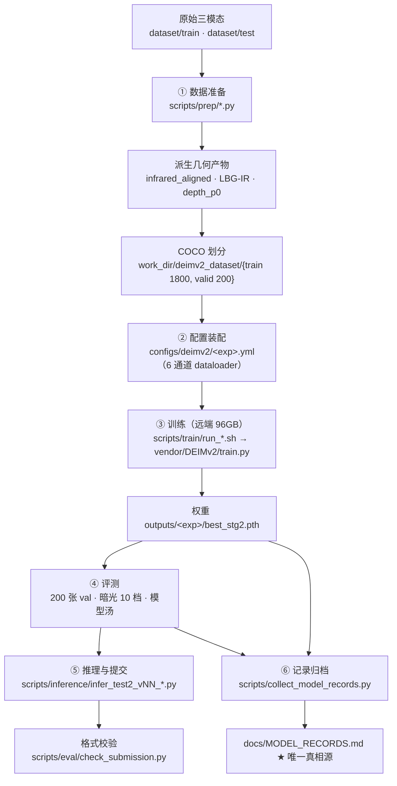

# AIC2026 项目统一工程规范 (PROJECT_SPEC.md)

**项目**：AIC2026 城市场景视觉多模态目标检测  
**模态**：可见光 (RGB) + 红外热成像 (IR / Heat / Raw) + 深度图 (Depth 16-bit)  
**单一主干框架**：DEIMv2 (DINOv3-ViT Backbone + HybridEncoder + RT-DETR/DFINE Style Decoder)  
**目标**：确立清晰的目录职能、数据链路、脚本分工、实验命名与提交验证统一标准，根除项目混乱。

---

## 1. 目录架构与职能划分 (Directory Hierarchy)

```
/home/constant/CodeBuddy/Dev/AIC/
├── docs/                 # 【唯一文档中心】按 5 大核心类别分层管理 (总索引见根目录 README.md)
│   ├── 01_competition/   # 官方竞赛细则、先验数据统计、格式范例与学术综述
│   ├── 02_collaboration_and_specs/ # 工程总规、全链路流程总纲、技术中台、全周期编年史与天梯榜
│   ├── 03_architecture_designs/    # 模型架构演进九阶段 (解耦融合 -> 双流 -> V6蓝图 -> V10小波条带 -> V12顶会合流 -> V13十模块 -> V14异构解耦 -> V20连续流形 -> V23零畸变2048超高清旗舰 官方实测 53.555 锁定前三甲/第四，全速冲击 60+)
│   ├── 04_audits_and_ablations/    # 攻坚审计与排雷报告 (红外对齐、权重溯源、CP消融定论)
│   ├── 05_postprocessing_and_inference/ # 合规安全后处理 (H-Flip共识) 与官方提交质检 SOP
│   └── archive/          # 历史过时记录归档 (旧跑分表，已被 MODEL_RECORDS.md 替代)
├── weight/               # 【唯一权重中心】预训练权重与基础 Backbone checkpoints
├── logs/                 # 【唯一日志中心】全部训练、评测与队列运行日志 (*.log)
├── dataset/              # 【原始数据集】竞赛原始数据 (train/test，只读，软链接至各处)
├── work_dir/             # 【运行时产物】deimv2_dataset 训练数据 · test_aligned_ir 缓存 · submissions 提交包 · audits 审计 · visualizations 可视化 · archives 归档 · 外部集
├── data_aux/             # 【外部辅助数据】BDD100K、暗光/掩码等大容量辅助集 (.gitignore 忽略)
├── outputs/              # 【分析产物】analysis 分析 · figures 图表 · metrics 指标 JSON · reports 报告 · submissions 提交包 · checkpoints 权重
├── scripts/              # 【自动化脚本集】预处理、训练驱动、评测、推理、分析、矩阵生成、公共库
├── vendor/               # 【第三方框架与资源】DEIMv2 (核心模型)、Depth-Anything-V2 及外部资料合集
├── archive/              # 【归档历史代码】废弃/探索性草稿脚本、快照与跨机迁移产物
├── work/                 # 【红外配准审计库】前期对齐攻坚探索探针 (详见 work/README.md)
├── AGENTS.md             # 【Agent 入口速查】项目定位、环境约定、红线与文档导航
├── README.md             # 【项目门面】竞赛简介、旗舰模型与战绩徽章
├── CODEBUDDY.md          # 【开发者/Agent 入口速查】环境、红线、命令与坑点 (软链 -> AGENTS.md)
└── MODEL_RECORDS.md      # 【唯一实验真相源】实验 mAP 与暗光评测结果总表 (软链 -> docs/MODEL_RECORDS.md)
```

### 根目录整洁红线：
1. **严禁在根目录直接放置临时脚本**（如 `_*.py`、`test*.py`）。临时代码统一放入 `archive/scratch/`。
2. **严禁在根目录直接输出日志**（如 `*.log`）。运行脚本必须统一重定向到 `logs/<exp_name>.log`。
3. **严禁在根目录直接堆放模型权重**。权重一律统一归入 `weight/`（必要时使用符号链接兼容旧配置）。
4. **严禁在根目录存放各类分析图表**（`*.png`, `*.html`）。一律输出至 `outputs/` 或 `work_dir/`。

---

## 2. 脚本分类与职责规范 (Scripts Architecture)

所有工程脚本严格按职能落入 `scripts/` 的相应子目录，不得跨界混杂：

| 目录 | 职责范围 | 典型代表脚本 |
|---|---|---|
| `scripts/prep/` | **数据准备与特征预处理**：RGB/IR/Depth 转换、配准对齐、LBG 红外、P0 深度、缓存、外部集生成 | `align_ir_pixel_pipeline.py`, `prep_ir_localbg.py`, `prep_p0_depth_unified.py`, `prep_deepir_cache.py` |
| `scripts/train/` | **训练驱动**：远端/本地自适应 Shell 驱动（GPU 排队、shm 缓存、磁盘守护）、显存探测 | `run_v28_full72ep_zoom_8gpu.sh`, `run_sovereign_v23_oldlabel1800_rtx6000.sh`, `probe_mem.py` |
| `scripts/inference/` | **正式推理与提交包生成**（V18 起逐代独立入口，含原生 TTA 与对撞审计） | `infer_test2_v28_disparity_awakening.py`, `generate_sovereign_v23_submissions.py` |
| `scripts/eval/` | **评测与提交把关**：官方口径评测器、暗光套件、模型汤、TTA/WBF、格式校验 | `official_competition_evaluator.py`, `eval_nightxx_suite.py`, `model_soup_apex.py`, `check_submission.py` |
| `scripts/gen/` | **批量配置与脚本生成**：自动化生成实验矩阵 yaml 与批量评测 shell | `gen_dfine_x_val_cfgs.py`, `mk_*_configs.py` |
| `scripts/analysis/` | **实验分析与可视化**：画 mAP 变化曲线、扫描日志、统计类分布、消融对比 | `plot_map_curve.py`, `scan_mAP.py`, `eval_exp*_*.py` |
| `scripts/audit/` `scripts/diagnostics/` | **审计与诊断探针**：通道/权重/数据一致性核查、故障复现 | `scripts/diagnostics/test_vram_measure.py` |
| `scripts/viz/` `scripts/utils/` | **可视化与通用小工具** | `scripts/viz/*.py` |
| `scripts/lib/` | **跨模块共享库**：夜化变换、去条纹、深度工具等公共 Python 模块 | `nightify_aic.py`, `destripe_1d.py`, `depth_utils.py` |
| `scripts/collect_model_records.py` | **全局总控工具**：重建唯一实验真相源 | `collect_model_records.py` |

> 每个子目录的**入口脚本与职责边界**详见本文 §7 全链路流程与 §8 最小闭环命令清单。

---

## 3. 运行环境与执行约定 (Environment & Execution)

### Conda 环境：
项目统一且仅使用 **`deimv2`** 环境（严禁调用已废弃的 `rfdetr` / `torch25`）：
- Python 路径：`/home/constant/miniconda3/envs/deimv2/bin/python`

### 环境变量与执行路径规范：
几乎所有脚本都需要加载 `scripts/lib` 与 `vendor/DEIMv2`，运行前务必导出标准前缀：
```bash
export PYTHONPATH="/home/constant/CodeBuddy/Dev/AIC/scripts/lib:/home/constant/CodeBuddy/Dev/AIC/vendor/DEIMv2:${PYTHONPATH:-}"
export PYTORCH_CUDA_ALLOC_CONF=expandable_segments:True
```

- **训练与框架入口**：`vendor/DEIMv2/train.py`。**必须 `cd vendor/DEIMv2` 执行**，且配置文件路径相对于该目录（如 `-c configs/deimv2/<exp>.yml`）。
- **推理与辅助脚本**：从仓库根目录 `/home/constant/CodeBuddy/Dev/AIC` 驱动。

---

## 4. 多模态数据标准与通道约定 (Data Standards)

### 4.1 6 通道标准特征布局
在训练加载器中，多模态输入张量统一遵循 6 通道布局（**由各实验 config 的 `dataset` 块显式指定，非数据集默认行为**，完整契约见本文 §7.1）：
- `ch 0 ~ 2`：**RGB 3 通道**（可见光，ImageNet Mean/Std 归一化）
- `ch 3`：**Aligned IR 1 通道**（对齐红外；早期 heat 残差口径为 $\text{clip}(\text{IR} - \text{Gray}, 0, 255)$）
- `ch 4`：**LBG-IR 1 通道**（局域背景抑制红外，弱热源增强）
- `ch 5`：**Depth 1 通道**（16-bit 毫米绝对深度，以 `raw16` 约定除以 $19999$ 归一化）

> 归一化常数：`mean=[0.485,0.456,0.406,0.5,0.5,0.5]`，`std=[0.229,0.224,0.225,0.5,0.5,0.5]`；`n_channels` 必须与 backbone 的 `ir_in_chans`/`depth_in_chans` 一致。

### 4.2 深度图读取硬性禁忌
- **严禁用 PIL `convert("L")`** 读取深度图！该操作会把 16-bit 整数直接截断为二值掩码（历史深坑）。必须通过 `Image.open(...)` 保持 `mode='I;16'` 并显式转换为浮点型张量。

### 4.3 目标检测类别与顺序（12 类固定）
`class_id`（0 ~ 11）：
`person (0), boat (1), animal (2), seat (3), sign (4), bicycle (5), car (6), ball (7), light (8), garbage can (9), uav (10), tricycle (11)`。

---

## 5. 模型配置与实验生命周期 (Model & Experiment Workflow)

> **完整流程见本文 §7**；本节只给最小心智模型。

```
[设计新 Backbone] ──> 在 multimodal_backbones.py 注册 (@register)
                            │
[配置实验参数]    ──> vendor/DEIMv2/configs/deimv2/<exp_name>.yml
                            │
[执行训练]        ──> cd vendor/DEIMv2 && train.py -c ... > logs/<exp_name>_train.log 2>&1
                            │
[10档暗光自动化评测] ─> run_<exp_name>.sh 驱动 10 档暗光 (day, night50 ... night0005)
                            │
[实验结果归档]    ──> python3 scripts/collect_model_records.py 自动更新 MODEL_RECORDS.md
```

### 算力环境与显存预算：
- **远端 8 卡节点（V28 起主力）**：
  - 入口：`ssh -p 32426 root@connect.westb.seetacloud.com`（本地 `~/.ssh/config` 记为 `Host seeta8`）
  - 硬件：**8 × NVIDIA RTX PRO 6000 Blackwell**；项目根 `/root/autodl-tmp/AIC`
  - 观察状态（2026-10-07）：容器**未挂载 GPU 驱动**（`v28_infer.log` → `Found no NVIDIA driver`），跑推理前需先确认 GPU 已分配
  - `/root/autodl-tmp` NVMe 容量紧张，训练脚本内自带磁盘守护剪枝
- **远端旗舰超算节点（V23 主训练）**：
  - 实例：`seeta` (`root@connect.westd.seetacloud.com:33715`)
  - 硬件：**NVIDIA RTX 6000 Ada / RTX PRO 6000（96 GB 显存旗舰）**。
  - **Sovereign V23（$1152 \times 2048$ 零畸变超高清）**：
    - `total_batch_size: 8`（物理 Batch 8，无需累积），稳态占用 **85.6 GB / 96 GB（89.2% 满载吞吐）**，预留 10.5 GB 安全缓冲；
    - 步频极速 **1.38s / 步**，单轮仅 **~5.8 分钟**；交付版 V23 为**两段式**：Stage A 补标口径 72 轮排程预训练 → Stage B 官方旧标注口径 TADL 精调 **21 轮**（全程单卡约 2 小时）。
- **本地工作站（开发调试）**：
  - RTX 5060 Ti（15.46 GiB），用于小脚本测试与单图推理验证。

---

## 6. 提交流水线与格式校验 (Submission Pipeline)

生成正式提交预测必须严格执行以下流水线：

1. **Sovereign V23 官方提交包生成与 Compact 压框**：
   ```bash
   python scripts/inference/generate_sovereign_v23_submissions.py
   ```
   > **【Compact 压框实战铁律】**:
   > - 官方 Phase 2 测试集真实目标总数严格为 **7,086 个**（均值 7.09 个/图）；
   > - 提交包总框数必须精准卡位在 **7,000 ~ 7,200 框**（$\tau \approx 0.505$ + 单图最大 60 框截断）；
   > - 实测 7,169 框一举打破天梯纪录斩获 **53.555 分（锁定前三甲/第四）**，超出或过少均会导致扣分！

2. **提交格式硬性把关（必须执行）**：
   ```bash
   python3 scripts/eval/check_submission.py outputs/submissions/submission_sovereign_v23_compact_7150.zip \
     dataset/test/AIC2026_PHASE_2_1000/visible
   ```
   **校验指标**：
   - 刚好 1,000 个 `.txt` 文件，文件名与 test 对应；
   - 逐行格式：`<class_id> <cx> <cy> <w> <h> <confidence>`，空格分隔；
   - 坐标在 $[0, 1]$ 范围内，归一化；
   - 置信度降序排列；
   - **CRLF (`\r\n`)** 换行符；
   - 每图不多于 60 个检测框；
   - 总框数在 7,000 ~ 7,200 之间；
   - 无目标图像写空文件。

---

## 7. 全链路流程 (End-to-End Pipeline)



| 阶段 | 入口 | 产物落点 |
| :--- | :--- | :--- |
| ① 数据准备 | `scripts/prep/` | `work_dir/deimv2_dataset/`、`work_dir/*_cache`、`data_aux/` |
| ② 配置装配 | `vendor/DEIMv2/configs/deimv2/<exp>.yml` | 配置即实验契约（`__include__` 深合并，后者覆盖前者） |
| ③ 训练 | `scripts/train/run_*.sh`（内部 `cd vendor/DEIMv2`） | `vendor/DEIMv2/outputs/<exp>/`、`logs/<exp>.log` |
| ④ 评测 | `scripts/eval/official_competition_evaluator.py`、`train.py --test-only` | `outputs/*.json`、`outputs/reports/` |
| ⑤ 推理提交 | `scripts/inference/`、`scripts/eval/predict_mm_tta.py` | `work_dir/submission_*` |
| ⑥ 记录归档 | `scripts/collect_model_records.py` | `docs/MODEL_RECORDS.md` |

### 7.1 数据契约（改动前必读）

| 路径 | 内容 |
| :--- | :--- |
| `dataset/train/{visible, infrared, infrared_aligned, depth, depth_p0, labels, new_labels_2000}` | 2000 组原始与派生三模态数据 |
| `dataset/test/AIC2026_PHASE_2_1000/` | 1000 组测试数据（含 `*_sr4x` 超分变体），**无标签** |
| `work_dir/deimv2_dataset/train/{images 1800, annotations}` | `instances_train.json`（**官方老标注，主线**）/ `instances_train_quality1998.json`（补标，**已被官方判为 FP，弃用**） |
| `work_dir/deimv2_dataset/valid/{images 200, annotations}` | `instances_val.json`（官方评测口径验证集） |

- **划分固定为 1800 / 200（seed=42）**，6 通道布局与归一化见 §4.1。
- 训练时 4 路图像经 `/dev/shm/aic_cache/*` 软链直读内存盘，避免每 epoch 重复解码。

### 7.2 推理入口与合规边界

| 脚本 | 用途 |
| :--- | :--- |
| `scripts/inference/infer_test2_vNN_*.py` | **当前主力**：单模型原生 6 通道 + 内生化 Flip-TTA，直接产提交包 |
| `scripts/inference/predict_sovereign_native.py` | 官方推荐统一原生推断入口 |
| `scripts/eval/predict_mm_tta.py` | 通用：同一模型 hflip × 多尺度共识 |
| `scripts/archive_legacy_postprocess/` ⛔ | **已废弃归档**：多模型 WBF、外部 CAA-SAHI 切片、外部多阈值投票，**不得用于提交** |

> **合规红线**：赛题第十一条禁止不同结构/不同训练阶段模型的简单集成（投票/平均/WBF）。只允许**单模型**内生化后处理与同模型多尺度推断；禁止全局配额排序外挂与测试集截断投机。

---

## 8. 最小闭环命令清单

```bash
export PY=/home/constant/miniconda3/envs/deimv2/bin/python
export PYTHONPATH="/home/constant/CodeBuddy/Dev/AIC/scripts/lib:/home/constant/CodeBuddy/Dev/AIC/vendor/DEIMv2:${PYTHONPATH:-}"
export PYTORCH_CUDA_ALLOC_CONF=expandable_segments:True

# ① 数据准备（首次或数据变更时）
$PY scripts/prep/prepare_dataset.py
$PY scripts/prep/prep_p0_depth_unified.py
cd vendor/DEIMv2 && $PY prep_deepir_cache.py && cd ../..

# ②③ 训练（远端；日志自动落 logs/）
bash scripts/train/run_v28_full72ep_zoom_8gpu.sh

# ④ 评测（官方口径 200 张 val）
$PY scripts/eval/official_competition_evaluator.py

# ⑤ 推理 → 提交包 → 校验
$PY scripts/inference/infer_test2_v28_disparity_awakening.py --config configs/deimv2/sovereign_v28_disparity_awakening_2048.yml --checkpoint outputs/sovereign_v28_disparity_awakening_2048/best_stg1.pth
$PY scripts/eval/check_submission.py work_dir/submission_v28 dataset/test/AIC2026_PHASE_2_1000/visible

# ⑥ 记录
$PY scripts/collect_model_records.py
```

---

## 9. 排错索引

| 症状 | 根因 | 处置 |
| :--- | :--- | :--- |
| `ImportError: nightify_aic` | 缺 `PYTHONPATH=scripts/lib` | 补全 §3 / §8 前缀 |
| 找不到 config、output_dir 跑错位置 | 未 `cd vendor/DEIMv2` | 所有 `train.py` 调用必须在该目录 |
| depth 变成黑白二值图 | 用 `PIL convert("L")` 读 16-bit | 改 `raw16`（`I;16` → `/19999`） |
| 通道数不匹配 / 精度崩塌 | `n_channels` 与 `ir_in_chans`/`depth_in_chans` 不一致 | 对齐 §4.1 与 config 数据块 |
| `only N / 3 blocks found` | RGB 与 aux 的 ViT 层数不等导致 `interaction_indexes` 越界 | 已由 `_scale_interaction_indexes()` 缩放，新增组合需复核 |
| 提交被官方判格式错 | 行尾非 CRLF / 超框数上限 / 坐标未归一化 | 跑 `check_submission.py` |
| 显存不足但 `nvidia-smi` 显示空闲 | 桌面合成器占用 ~12 GiB | 关合成器或调 `accum_steps` |
| 旧 `predict_*.py` 集体报错 | 依赖已废弃的 `rfdetr` 环境 | 改用 `predict_mm_tta.py` 与 `scripts/inference/` |


## 10. 当前修正基准（2026-10-21）

用户指定先收敛正确性修复，再统一整理未确定改进项。唯一配置为 `vendor/DEIMv2/configs/deimv2/aic_clean_baseline_v1.yml`；定义、修复清单、验收边界和候选统一见 [CLEAN_BASELINE.md](CLEAN_BASELINE.md)。代码与功能契约通过不等于已经训练或有新mAP。旧章节中的effective batch乘法、按测试集总框数定优劣等历史叙述不能作为该基准的契约。
