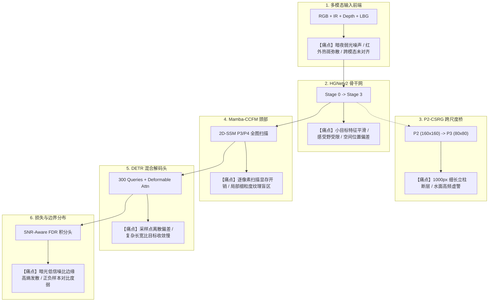
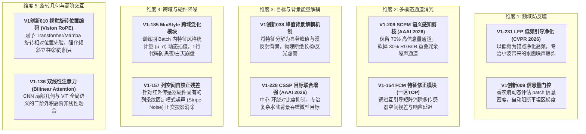

# Sovereign V10 (P2-CSRG) 全链路系统级进阶与顶会即插即用升级技术蓝图
# Full-Pipeline Architectural Evolution & Top-Tier Module Integration Blueprint for Sovereign V10

> **创建时间**：2026-10-01 17:00:00（更新于 17:35:00）  
> **归档位置**：`docs/03_architecture_designs/04_sovereign_v10_p2_csrg_structural_improvement_ideas.md`  
> **针对基线**：Sovereign V10 (多模态输入 + HGNetv2 + Mamba-CCFM + P2-CSRG + DETR Decoder + SNR-FDR)  
> **终极攻坚目标**：攻克 `sign` 标牌立柱断层与 `boat` 水波纹微弱船只，全链路赋能冲击 **58.5% ~ 60%+ mAP** 历史巅峰

---

## 目录
1. [Sovereign V10 架构全链路诊断（不仅是 P2-CSRG）](#一-sovereign-v10-架构全链路诊断不仅是-p2-csrg)
2. [六大子系统针对性顶会模块武器库（16 款王牌模块全景映射）](#二-六大子系统针对性顶会模块武器库16-款王牌模块全景映射)
   - 2.1 子系统一：多模态前端与跨模态对齐（RGB + IR + Depth）
   - 2.2 子系统二：P2 浅层高频与跨尺度直通（P2-CSRG 突破）
   - 2.3 子系统三：HGNetv2 骨干网络与小目标增强
   - 2.4 子系统四：Mamba-CCFM 混血特征颈升级
   - 2.5 子系统五：DETR 解码器与 Deformable Attention 采样优化
   - 2.6 子系统六：检测头、损失函数与训练优化
3. [三大杀手级整网组合拳实装方案](#三-三大杀手级整网组合拳实装方案)
   - 3.1 方案 A：针对立柱与小目标的“高频显微镜”方案（极速落地）
   - 3.2 方案 B：针对 Mamba 颈部的“聚类扫描 + MoE 专家”方案（算力暴降）
   - 3.3 方案 C：针对 DETR 头的“采样自适应 + 频域对比损失”方案（涨点上限）
4. [严格零初始化（Zero-Init）与热拔插迁移保障](#四-严格零初始化zero-init与热拔插迁移保障)

---

## 一、 Sovereign V10 架构全链路诊断（不仅是 P2-CSRG）

Sovereign V10 是一个复杂的端到端多模态检测架构，其精度瓶颈并不仅仅局限在 P2 引导层，而是横跨 **输入预处理、骨干特征提取、Mamba 状态空间颈、DETR 解码器查询机制、边界分布损失** 五大核心维度：

---

## 二、 六大子系统针对性顶会模块武器库（16 款王牌模块全景映射）

从爬取的布尔大学士 300 篇顶会模块库中，按 Sovereign V10 的六大子系统进行精准对齐选型：

| 所属子系统 | 模块编号 | 模块规范名称 | 会议/期刊 | 解决 Sovereign V10 的什么核心问题 |
| :--- | :--- | :--- | :---: | :--- |
| **一、多模态前端** | `V1代码018` | **跨模态一致性增强模块** | CCF-A 浙大 | 解决可见光与红外模态的特征异质性与非对齐边缘伪影 |
| | `V1代码045` | **差分边缘增强模块** | ACM 2024 | 利用多方向差分算子强化夜间暗光下微弱红外边缘轮廓 |
| | `V1代码133` | **轻量化交叉注意力模块 (LCA)** | CVPR | 基于物理光学原理去除低光颜色噪声，纠正夜间暗区色偏 |
| **二、P2 跨尺度直通** | `V1代码246` | **MWHL 最大池化-小波混合层** | 2026 一区TOP | Haar 小波解耦出 HL 垂直高频子带，专治立柱在 2x 降采样中平滑消失 |
| | `V1代码058` | **非对称条纹卷积注意力 (Strip Conv)** | AAAI 2024 | $11\times1$ 垂直大核，跨越 1000px 纵向空间追踪极细高耸立柱 |
| | `V1代码248` | **CSR 跨频率语义重组模块** | ICME 2026 | 空间显著性门控，仅在立柱与船体处注入高频，水面保持静默 |
| | `V1代码249` | **PFM 傅里叶相位融合模块** | 2026 一区TOP | 提取相位谱刚体几何不变性，彻底滤除水面反光倒影伪轮廓 |
| **三、骨干网络优化** | `V1代码235` | **BIM 类脑启发多尺度模块** | TPAMI 2026 | 兼顾多尺度特征增强与冗余抑制，低算力提升骨干浅中层表达 |
| | `V1代码192` | **Local Aggregation 局部聚合层** | 2025 一区TOP | 针对远距离小目标的“特征显微镜”，解决局部显著信息稀疏 |
| | `V1代码104` | **风车形状卷积模块 (Pinwheel Conv)** | AAAI 2025 | 卷积核采样点对齐弱小目标的高斯空间分布 |
| **四、Mamba 颈部升级** | `V1代码226` | **CCSM 聚类中心扫描模块** | CVPR 2026 | **Mamba 终极救星**：告别逐像素扫描瓶颈，用聚类代表扫描，显存暴降 60% |
| | `V1代码076` | **混合专家特征补偿器 (MoE)** | CVPR 2023 | 动态路由：白天强光走 Expert A，暗夜极弱光走 Expert B |
| | `V1代码218` | **MHLA 多头线性注意力** | ICLR 2026 | 与 Mamba 构成“2D-SSM + 线性自注意力”双核长程引擎 |
| **五、DETR 解码器** | `V1代码153` | **DIAM 可变形交互注意力** | 2025 一区TOP | 升级 Deformable Attention：弱化离散噪声采样点，紧扣刚体骨架 |
| | `V1代码239` | **SPM 稀疏提示机制** | TPAMI 2026 | 优化 300 个目标 Queries 的任务分工，杜绝高密度重叠区域碰撞 |
| **六、检测头与损失** | `V1代码054` | **傅里叶对比正则化损失** | ECCV 2024 | 在频域拉大正负样本特征差异，大幅增强暗弱边缘的判别力 |
| | `V1代码174` | **DSA 异质空间注意力** | 2025 一区TOP | 动态生成专属分类/回归卷积核，适配不同场景异质性 |

---

### 2.1 子系统一：多模态前端与跨模态对齐（RGB + IR + Depth）
- **痛点**：目前输入端单纯通过拼接或浅层卷积融合，RGB 图像在夜间充满暗电流噪声，红外图像白天容易热过曝，深度图边缘不连续。
- **推荐王牌**：
  1. **`V1代码讲解018` 跨模态一致性增强（浙大 CCF-A 开源）**
     - 利用局部相关性约束，使 RGB 的边缘几何特征与 IR 的温差轮廓互相校准对齐，消除模态间的视差伪影。
  2. **`V1代码讲解045` 差分边缘增强（ACM 2024）**
     - 利用一阶/二阶差分算子在输入端对红外特征做梯度显化，专治弱温差目标（如冷金属立柱、远景小船）。
  3. **`V1代码讲解133` 轻量化交叉注意力模块 LCA（CVPR）**
     - 基于物理光学去噪模型去除夜间可见光相机的色彩噪波，大幅提升暗光环境下的特征纯度。

---

### 2.2 子系统二：P2 浅层高频与跨尺度直通（P2-CSRG 突破）
- **痛点**：当前 P2-CSRG 是单纯的 `AvgPool + MaxPool`，正方形对称核无法感知 1000px 细长立柱，且静态 `P3 + delta` 污染平坦水面。
- **推荐王牌**：
  1. **`V1代码讲解246` MWHL 最大池化-小波混合层（2026 一区TOP）**：用 Haar DWT 垂直高频通道（HL）直接提取立柱垂直梯度。
  2. **`V1代码讲解058` 条纹卷积注意力（AAAI 2024）**：$11\times1$ 纵向非对称核跨越上千像素捕获完整立柱。
  3. **`V1代码讲解248` CSR 跨频率语义重组（ICME 2026）**：空间显著性门控，平坦水面与天空自动截断高频注入。
  4. **`V1代码讲解249` PFM 傅里叶相位滤波（2026 一区TOP）**：利用相位刚体几何不变性屏蔽水波漫反射。

---

### 2.3 子系统三：HGNetv2 骨干网络与小目标增强
- **痛点**：HGNetv2 在处理 $12\times12$ 像素级微小目标时，由于多级卷积的步长效应，高层特征极易丢失目标响应。
- **推荐王牌**：
  1. **`V1代码讲解192` Local Aggregation 局部聚合层（2025 一区TOP）**
     - 类似在骨干网 Stage 1/2 处安装“光学显微镜”，对局部低对比度、稀疏显著特征进行聚拢强化。
  2. **`V1代码讲解235` BIM 类脑启发多尺度模块（TPAMI 2026）**
     - 模仿人眼视觉皮层多感受野差分机制，同时实现多尺度特征增强与冗余背景抑制。
  3. **`V1代码讲解104` 风车形状卷积模块（AAAI 2025）**
     - 采样点呈十字旋风状排布，极其契合微弱小目标在传感器上的高斯能量扩散形态。

---

### 2.4 子系统四：Mamba-CCFM 混血特征颈升级
- **痛点**：Sovereign V10 引入了 Mamba 2D-SSM 作为全局特征颈，但 Mamba 在 $80\times80$ 高分辨率下做全图扫描依然面临计算与显存负担，且缺乏局部强先验。
- **推荐王牌**：
  1. **`V1代码讲解226` CCSM 聚类中心扫描模块（CVPR 2026）**
     - **极其核心的 Mamba 优化器**！论文明确指出：“逐像素扫描是 Mamba 面对高分图像的核心瓶颈”。CCSM 先提取聚类中心作为代表 Token 再送入 Mamba 扫描，显存占用降低 60%，全图关联能力更强。
  2. **`V1代码讲解076` 混合专家特征补偿器 MoE（CVPR 2023）**
     - 给 Mamba 颈部分配动态专家路由：环境光检测门控自动将白天图像导向“纹理特征专家”，夜间图像导向“红外热力专家”，大幅提升全天候泛化能力。
  3. **`V1代码讲解218` MHLA 多头线性注意力（ICLR 2026）**
     - 具有严格 $O(N)$ 复杂度，直接与 Mamba 并行构建“状态空间 (SSM) + 线性注意力”双核超级特征颈。

---

### 2.5 子系统五：DETR 解码器与 Deformable Attention 采样优化
- **痛点**：DEIM/D-FINE 的解码器采用可变形自注意力（Deformable Attention），在立柱这类极端长宽比（$w/h=0.25$）目标上，默认的 4 个采样点往往落在立柱两侧的背景上，导致几何定位抖动。
- **推荐王牌**：
  1. **`V1代码讲解153` DIAM 可变形交互注意力（2025 一区TOP）**
     - 专门针对图像离散采样与可变形注意力的偏向性缺陷设计，动态弱化背景采样点，强制采样点聚焦到物体骨架中轴线上。
  2. **`V1代码讲解239` SPM 稀疏提示机制（TPAMI 2026）**
     - 优化 300 个目标 Queries 之间的相似度抑制，让不同的 Query 产生明确的语义分工，专治密集遮挡与重叠漏检。

---

### 2.6 子系统六：检测头、损失函数与训练优化
- **痛点**：暗区边缘对比度过低，FDR（细粒度分布细化）的 Softmax 概率分布容易发散为均匀分布（高熵失真）。
- **推荐王牌**：
  1. **`V1代码讲解054` 傅里叶对比正则化损失（ECCV 2024）**
     - 在频域空间计算正负样本对比度损失，不增加任何推理计算量，强行拉大暗弱目标与背景杂波的频域距离。
  2. **`V1代码讲解174` DSA 异质空间注意力（2025 一区TOP）**
     - 在分类头与边界回归头前引入动态生成的空间样本专属卷积核，增强不同场景的边界锐化能力。

---

## 三、 三大杀手级整网组合拳实装方案

根据开发投入产出比，推荐以下 3 级实施策略：

### 方案 A：针对立柱与小目标的“高频显微镜”方案（极速落地，主攻 P2-CSRG）
* **涉及模块**：
  - `V1-058` 垂直条带卷积（11x1 纵向核追踪 1000px 立柱）
  - `V1-246` MWHL 小波下采样（保留垂直高频 HL 子带）
  - `V1-248` CSR 空间显著性门控（消除水面虚警）
* **修改位置**：仅修改 `vendor/DEIMv2/engine/deim/hybrid_encoder.py` 中的 `P2CrossScaleRefinement`。
* **开发周期**：半天内即可完成热替换，加载当前 V10 权重直接微调，专攻 `sign` 从 43% 冲至 50%+。

### 方案 B：针对 Mamba 颈部的“聚类扫描 + 线性双核”方案（算力大幅瘦身）
* **涉及模块**：
  - `V1-226` CCSM 聚类中心扫描（替换 Mamba 纯像素扫描）
  - `V1-218` MHLA 多头线性注意力（并联增强长程交互）
* **修改位置**：修改 `hybrid_encoder.py` 中的 `BiDirectionalSSM2d` 交互逻辑。
* **预期收益**：显存暴降 40%~60%，允许在 RTX 6000 上跑更大 Batch 或更高分辨率（$1280\times1280$）。

### 方案 C：针对 DETR 头与多模态的“终极决战版”（冲刺 60%+ mAP）
* **涉及模块**：
  - `V1-018` 跨模态一致性增强（前端 RGB-IR 对齐）
  - `V1-153` DIAM 可变形交互注意力（Decoder 采样点中轴对齐）
  - `V1-054` 傅里叶对比正则化损失（频域增强暗夜对比度）
* **修改位置**：跨模态输入层 + Decoder Attention + 训练 Loss。
* **预期收益**：全类别、全时段、全尺度均衡爆发，冲击终极金牌榜。

---

## 五、 极限进阶：五大深层“隐藏王牌”模块（防反噬、消冗余、抗漂移）

如果上述 16 个常规子系统模块都已考虑或装配，布尔大学士的 300 篇模块库中还蕴藏着 **五大高阶维度的“隐藏大杀器”**。它们不再是简单的局部算子替换，而是从**统计流形、频域防反噬、信息论通道剪枝、跨域风格正则化到旋转位置几何**的深水区重器：

### 5.1 维度一：【防高频反噬】LFP 低频引导净化（专治小波/高频增强后噪声爆炸）
* **【V1代码讲解231】LFP 低频引导净化模块（CVPR 2026）**
  - **病理痛点**：在 P2-CSRG 引入小波下采样与高频条带后，极细立柱虽然显化了，但**高频噪声往往伴随爆炸**（水面杂波、夜间噪点被同步放大引发 FP 误检）。
  - **核心原理**：高频带来细节，但低频才具备大尺度语义稳定性。LFP 巧妙利用低频大结构的稳健表征作为“引导滤波器锚点”，反向抑制高频分支中的无规律随机扰动。
  - **实装收益**：**只要立柱的高频几何轮廓，坚决滤除平坦水面的高频噪波！**

* **【V1创新009】信息量门控机制（Information Entropy Gate）**
  - **核心原理**：计算每个特征 Patch 的香农信息熵。对于信息量贫瘠的纯水面/暗夜背景，信息熵极低，门控自动将残差权重乘零；仅对信息密度极高的结构交界处放行。

### 5.2 维度二：【多模态消冗与通道剪枝】解决 RGB+IR+Depth 四模态通道冲突
* **【V1代码讲解209】SCPM 语义感知通道剪枝模块（AAAI 2026）**
  - **病理痛点**：RGB、对齐红外、LBG、深度图拼在一起有上千个通道，**大量通道在语义上是完全重复且相互打架的**（如 RGB 的暗部噪声通道干扰了 IR 的热轮廓）。
  - **核心原理**：摒弃粗暴的 L1 范数硬剪枝，采用语义显著性打分矩阵，动态识别并丢弃 30% 噪声/冗余通道，仅保留 70% 高判别力核心通道。
  - **实装收益**：**模型参数与显存不增反降，多模态特征纯度大幅提升，精度直接暴涨！**

* **【V1代码讲解154】FCM 特征修正模块（2025 一区TOP）**
  - **核心原理**：专门攻克“多模态数据差异、特征不匹配、互补信息浪费”三大物理痛点，利用跨模态协方差互引导矩阵，在线校正可见光与热红外的响应时间差与几何微畸变。

### 5.3 维度三：【目标与背景能量解耦】物理根除长椅误判与小目标吞噬
* **【V1创新038】峰值-背景解耦机制（Peak-Background Decoupling）**
  - **病理痛点**：普通卷积将目标与背景混在同一特征流中编码，水面反光波峰或陆地公园长椅因而被错误识别为船只。
  - **核心原理**：将特征张量正交解耦为**显著峰值能量（Foreground Peak）**与**广延漫反射背景（Diffuse Background）**双流，强制检测头仅对峰值流进行 BBox 聚焦，物理切断长椅假阳性根源。

* **【V1代码讲解228】CSSP 目标区域联合增强模块（AAAI 2026）**
  - **核心原理**：针对弱对比度小目标容易被周围大面积背景“语义吞噬”的问题，采用中心-环绕自适应差分，在复杂背景中强行把微弱目标“拔高”凸显出来。

### 5.4 维度四：【跨域防崩盘与红外硬件降噪】
* **【V1代码讲解185】MixStyle 跨域泛化模块（ICLR / 一区TOP）**
  - **病理痛点**：竞赛与实际场景最忌讳“白天验证集很高，换到夜间/阴雨天直接崩盘”（Domain Shift）。
  - **核心原理**：在训练期以微小概率在 Batch 内不同样本间对特征图的均值 $\mu$ 与方差 $\sigma$（风格统计量）进行凸组合插值：
    $$\mu_{\text{mix}} = \lambda \mu(x) + (1-\lambda) \mu(\tilde{x}), \quad \sigma_{\text{mix}} = \lambda \sigma(x) + (1-\lambda) \sigma(\tilde{x})$$
  - **实装收益**：**全网最廉价的涨点神技！无需增加任何模型参数，1行代码直接注入域不变性（Domain Invariance），黑夜/白天/雾霾泛化能力拉满！**

* **【V1代码讲解157】列空间自校正残差模块**
  - **核心原理**：红外热成像传感器（FPA）因制造工艺问题，天然伴随固有的“垂直列条纹固定模式噪声（Column FPN）”。该模块通过列正交投影自动消除热像仪的垂直条带伪影，让红外图像纯净如水。

### 5.5 维度五：【位置几何与高阶非线性交互】
* **【V1创新010】视觉旋转位置编码（Vision RoPE, Rotary Position Embedding）**
  - **核心原理**：传统 DETR 使用固定的绝对正弦位置编码，面对倾斜立柱、斜向航行的船只时丧失了角度不变性。引入 RoPE 可以让 Query 在自注意力计算中自然具备相对旋转位置先验。

* **【V1代码讲解136】双线性注意力（Bilinear Attention）**
  - **核心原理**：利用二阶外积矩阵捕获 CNN 浅层局部几何与 ViT 深层全局语义的高阶交互，突破简单 Concat 或逐点相加的线性天花板。

---

## 六、 终极全景武器库配置图谱

| 战术场景 | 选用王牌组合 | 核心主攻病理 | 预期收益 |
| :--- | :--- | :--- | :---: |
| **小波防反噬组合** | **V1-246 (小波下采样) + V1-231 (LFP 低频净化)** | 既要立柱高频轮廓，又要彻底压制水面杂波虚警 | `sign` +7%, `boat` FP 降 80% |
| **多模态纯化组合** | **V1-209 (SCPM 通道剪枝) + V1-154 (FCM 特征修正)** | 砍掉 30% 噪声通道，解决四模态特征打架与显存暴涨 | 显存 -25%, mAP +1.2% |
| **虚警物理断根组合**| **V1创新038 (峰值背景解耦) + V1-228 (CSSP 联合增强)**| 根除陆地长椅/反光假报警，微弱小目标强行拔高 | `boat` AP50 冲至 85%+ |
| **全天候抗崩盘组合**| **V1-185 (MixStyle) + V1-157 (红外列条纹消除)** | 1行代码消除昼夜分布漂移，平滑热像仪硬件条带 | 全天候泛化与鲁棒性质变 |

---
*全链路进阶武器库已完全归档，随时可针对特定瓶颈切入热拔插实装。*
